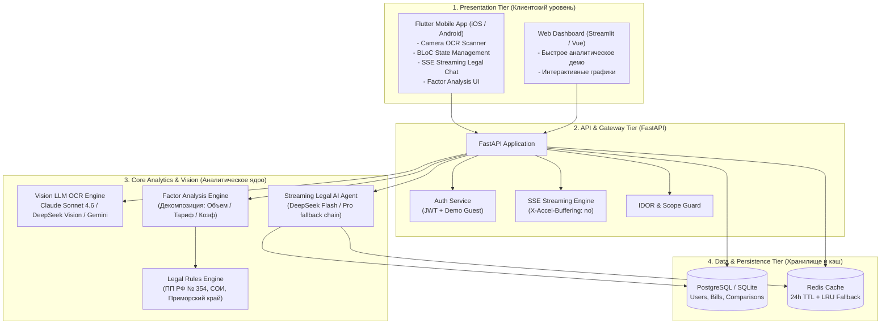
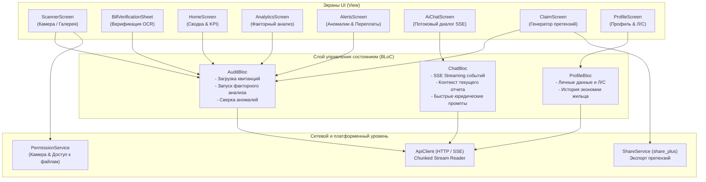

# 🏠 UtilityLens — Интеллектуальный помощник по ЖКХ

> **UtilityLens** — сквозная мультиплатформенная система для анализа квитанций ЖКХ, факторного разложения дельт начислений, выявления правовых аномалий и консультации жильцов через специализированного ИИ-юриста в реальном времени.

[](https://fastapi.tiangolo.com)
[](https://flutter.dev)
[](https://python.org)
[](https://docker.com)
[](LICENSE)

---

## 📌 Оглавление
1. [Проблема и цель проекта](#-проблема-и-цель-проекта)
2. [Архитектура системы (4 уровня)](#-архитектура-системы-4-уровня)
3. [Математический аппарат: Факторный анализ](#-математический-аппарат-факторный-анализ)
4. [Региональная правовая специфика (Владивосток и Приморье)](#-региональная-правовая-специфика-владивосток-и-приморье)
5. [Мультимодальный OCR и Vision Pipeline](#-мультимодальный-ocr-и-vision-pipeline)
6. [ИИ-Юрист по ЖКХ (Streaming AI Agent)](#-ии-юрист-по-жкх-streaming-ai-agent)
7. [Мобильное приложение (Flutter)](#-мобильное-приложение-flutter)
8. [Отказоустойчивость, Кэш и База Данных](#-отказоустойчивость-кэш-и-база-данных)
9. [Структура репозитория](#-структура-репозитория)
10. [Развертывание и быстрый старт](#-развертывание-и-быстрый-старт)
11. [Безопасность и соответствие 152-ФЗ](#-безопасность-и-соответствие-152-фз)

---

## ❓ Проблема и цель проекта

Квитанция на оплату жилищно-коммунальных услуг — один из самых непрозрачных финансовых документов для граждан:
- **Информационный шум и сокращения:** *ГВС Тн, ГВС Тэ, ХВС для ГВС, КР на СОИ, водоотведение двухкомпонентное, повышающий коэф.*
- **Необъяснимый рост итоговой суммы:** при росте чека на 1 500 ₽ гражданин не понимает, потратила ли семья больше воды/света, произошла ли плановая индексация тарифов, включен ли перерасчет управляющей компании или начислен штрафной коэффициент.
- **Скрытые переплаты:** просрочка поверки индивидуального прибора учета (ИПУ) ведет к автоматическому начислению повышающего коэффициента 1.5 (п. 60(1) ПП РФ № 354), что увеличивает платежи на тысячи рублей незаметно для плательщика.

**Цель UtilityLens** — автоматизировать разбор квитанций любого поставщика, математически точно декомпозировать причины изменения счета и предоставить жильцу готовый юридический инструмент защиты его прав.

---

## 🏗 Архитектура системы (4 уровня)

Система спроектирована по модульной 4-уровневой сервис-ориентированной архитектуре:



### 1. Presentation Tier (Клиентский уровень)
- **Flutter Mobile App:** Кроссплатформенное приложение (Android / iOS) с поддержкой фотосъемки квитанций, пошагового сравнения периодов, водопадных диаграмм расходов и чата с ИИ-юристом в режиме реального времени.
- **Web Interface:** Аналитический дашборд для наглядной презентации и десктопного использования.

### 2. API & Gateway Tier (Бэкенд-шлюз)
- **FastAPI (Python 3.11+):** Высокопроизводительный асинхронный бэкенд.
- **Server-Sent Events (SSE):** Потоковая отдача ответов ИИ-агента (`/api/v1/chat/stream`) без буферизации (`X-Accel-Buffering: no`), обеспечивающая время до первого токена (TTFT) менее 500 мс.
- **Безопасность:** Защита от IDOR (Insecure Direct Object Reference) с проверкой принадлежности квитанций и отчетов текущему пользователю.

### 3. Core Engine (Аналитика и AI)
- **Vision OCR Extraction:** Извлечение табличных данных из фото/сканов квитанций в структурированную схему `BillDocument`.
- **Factor Analysis:** Точный математический расчет влияния каждого изолированного фактора на дельту чека.
- **Legal Rule Engine:** Проверка начислений на соответствие нормативам ЖКХ и региональным постановлениям Приморского края.

### 4. Data & Persistence Tier (Данные и кэширование)
- **Реляционная БД:** SQLAlchemy + SQLite / PostgreSQL со схемой хранения пользователей, метаданных квитанций и истории сравнений. Автоматическая миграция схемы при старте.
- **Кэширующий слой:** Двухуровневый кэш отчетов: первичный Redis с TTL 24 часа + ограниченный LRU-кэш в оперативной памяти (до 1000 элементов) с авто-реконнектом при сбоях сети.

---

## 🧮 Математический аппарат: Факторный анализ

Для ответа на вопрос *«Почему сумма изменилась?»* система применяет строгую формулу декомпозиции дельты стоимости каждой коммунальной услуги.

Для услуги со стоимостью $S = V \cdot T \cdot K$ (где $V$ — объем, $T$ — тариф, $K$ — повышающий коэффициент) изменение стоимости между текущим месяцем ($c$) и предыдущим ($p$) раскладывается на компоненты:

$$\Delta S = S_c - S_p = \Delta S_{vol} + \Delta S_{tar} + \Delta S_{coeff} + \Delta S_{cross} + \Delta S_{recalc} + \Delta S_{penalty}$$

### Изолированные эффекты:
1. **Эффект изменения объема потребления ($\Delta S_{vol}$):**
   $$\Delta S_{vol} = (V_c - V_p) \cdot T_p \cdot K_p$$
   *Показывает, сколько потребитель переплатил/сэкономил исключительно из-за изменения расхода ресурса при старом тарифе.*

2. **Эффект изменения тарифа ($\Delta S_{tar}$):**
   $$\Delta S_{tar} = V_c \cdot (T_c - T_p) \cdot K_p$$
   *Показывает влияние городской индексации стоимости единицы ресурса на фактический объем потребления.*

3. **Эффект повышающего коэффициента ($\Delta S_{coeff}$):**
   $$\Delta S_{coeff} = V_c \cdot T_c \cdot (K_c - K_p)$$
   *Выделяет штрафную переплату при просрочке поверки счетчика ($K = 1.5$) или самовольном подключении ($K = 10$).*

4. **Перекрестный эффект ($\Delta S_{cross}$):**
   $$\Delta S_{cross} = (V_c - V_p) \cdot (T_c - T_p)$$

5. **Разовые перерасчеты и штрафы:**
   $$\Delta S_{recalc} = \text{Recalc}_c - \text{Recalc}_p, \quad \Delta S_{penalty} = \text{Penalty}_c - \text{Penalty}_p$$

### Учет многокомпонентных услуг (Multi-Component Matching):
В квитанциях строки часто делятся на тарифные зоны (День / Ночь / Пик) или физические компоненты (Теплоноситель в $м^3$ и Тепловая энергия в Гкал). Анализатор связывает строки с помощью составных ключей `service_code:qualifier`, предотвращая коллизии и потерю данных.

---

## 🏛 Региональная правовая специфика (Владивосток и Приморье)

Аналитический модуль и ИИ-юрист UtilityLens содержат встроенную базу знаний по нормативной базе ЖКХ с учетом специфики Владивостока и Приморского края:

| Нормативный акт | Отраслевая норма | Реализация в UtilityLens |
|---|---|---|
| **ПП РФ № 354 (п. 60(1))** | При истечении межповерочного интервала ИПУ первые 3 месяца расчет ведется по среднему, с 4-го — по нормативу с **коэффициентом 1.5**. | Детектор автоматически вычисляет переплату $K = 1.5$ и формирует рекомендацию о срочной поверке прибора. |
| **Двухкомпонентный тариф ГВС** | Горячее водоснабжение делится на: 1) Теплоноситель (ХВС, $м^3$), 2) Тепловая энергия на подогрев воды (Гкал). | Нормализатор парсит оба компонента, сверяет норматив подогрева (Гкал/$м^3$) и исключает задвоение начислений. |
| **КР на СОИ (ПП РФ № 92)** | Расходы на содержание общего имущества (ХВС, ГВС, Э/Э, Водоотведение). | Сверка с нормативами Приморского края и выявление скачков при годовом перерасчете ОДН. |
| **Региональные операторы** | Специфика квитанций ПАО «ДЭК» (Дальэнергосбыт), КГУП «Примтеплоэнерго», АО «РКЦ», Фонда капремонта ПК. | Предобученные промпты распознавания макетов дальневосточных квитанций и лицевых счетов. |

---

## 👁 Мультимодальный OCR и Vision Pipeline

Обработка сканов и фотографий квитанций построена на устойчивом каскаде мультимодальных нейросетей:

```
[Фото квитанции] 
       │
       ▼
[Оптимизация и Base64 кодирование]
       │
       ▼
[Vision Model Fallback Cascade]
       ├── 1. claude-sonnet-4.6-tunnelcode (Основная модель высокой точности)
       ├── 2. deepseek-v4-flash-vision      (Быстрый резервный шлюз)
       └── 3. gemini-3.7-flash              (Резервная модель Google)
       │
       ▼
[JSON Clean & Envelope Unwrap]
       │
       ▼
[Pydantic BillDocument Validation]
```

1. **Автоматическое исправление артефактов:** Модуль очищает markdown-теги ` ```json `, обрезает внешние ключи-оболочки (`receipt`, `bill`, `data`) и приводит даты формата *«Октябрь 2026»* к ISO `2026-10-01`.
2. **Гарантия типов данных:** Корректная обработка нулевого расхода ($0.0 \text{ } м^3$), предотвращающая ложное превращение нулевого потребления в единицу при пустующих квартирах.

---

## ⚖️ ИИ-Юрист по ЖКХ (Streaming AI Agent)

В UtilityLens встроен интеллектуальный ассистент, способный вести непрерывный юридический диалог по конкретной квитанции пользователя:

- **SSE Streaming:** Потоковая генерация токенов через SSE без буферизации прокси-сервером Nginx.
- **Встроенные инструменты (Agent Tools):**
  - `get_report`: Извлечение полного факторного отчета по квитанции из кэша Redis или восстановление из БД.
  - `explain_service`: Генерация разъяснения сложной услуги (СОИ, ГВС Тэ) простыми словами.
  - `check_legality`: Анализ правомерности начислений со ссылкой на пункты ПП РФ № 354.
- **Отказоустойчивая цепочка моделей:**
  - `deepseek-v4-flash-tunnelcode` — сверхбыстрая модель ответа (<500 мс до первого токена).
  - `claude-sonnet-4.6-tunnelcode` / `deepseek-v4-pro` — углубленный юридический анализ.
  - `gpt-4o-mini` — резервный шлюз OpenAI.

---

## 📱 Мобильное приложение (Flutter)

Мобильный клиент UtilityLens для iOS и Android разработан на фреймворке **Flutter 3.x** с использованием чистой архитектуры и паттерна управления состоянием **BLoC (Business Logic Component)**. Приложение выполняет роль персонального карманного юриста и финансового аудитора коммунальных платежей.

### Архитектура и State Management (BLoC)



### Ключевые возможности и экраны:

1. **Сканирование квитанций (`ScannerScreen`, `ReceiptUploadBottomSheet`):**
   - Интеллектуальный захват документа через камеру смартфона с рамкой позиционирования или выбор файлов из галереи / PDF.
   - Клиентская оптимизация размера изображения перед отправкой на Vision OCR бэкенда для ускорения обработки и экономии мобильного трафика.

2. **Интерактивная верификация начислений (`BillVerificationSheet`):**
   - Перед расчетом дельт пользователь видит распознанные строки услуг, объемы, тарифы и итоговые суммы.
   - Возможность моментальной корректировки значений при смазанных или нечетких фотографиях квитанций.

3. **Сводка и KPI начислений (`HomeScreen`, `HeroBillCard`):**
   - Крупная карточка текущего платежа с цветовой индикацией динамики (рост/снижение в рублях и процентах).
   - Быстрый доступ к критическим аномалиям, истории квитанций и диалогу с ассистентом.

4. **Факторная аналитика дельт (`AnalyticsScreen`, `ServiceItemRow`):**
   - Наглядная декомпозиция: четкое разделение переплаты на **эффект тарифа** (городская индексация) и **эффект объема** (фактическое потребление семьей).
   - Поддержка многокомпонентных тарифов (День / Ночь, Теплоноситель / Тепловая энергия ГВС).

5. **Центр предупреждений и аномалий (`AlertsScreen`, `AnomalyBottomSheet`):**
   - Мгновенная подсветка начислений с повышающим коэффициентом $1.5$ (п. 60(1) ПП РФ № 354).
   - Предупреждения о скачках расхода ресурсов $>30\%$, появлении новых нетипичных строк и пени.
   - Карточка подробностей с указанием статьи закона и рекомендацией, что предпринять.

6. **Потоковый чат с ИИ-юристом (`AiChatScreen`):**
   - Полноэкранный юридический диалог с поддержкой **SSE Streaming** — ответы генерируются по словам без задержки.
   - Быстрые юридические подсказки в один тап: *«Почему вырос счет?»*, *«Законен ли коэф 1.5?»*, *«Как оспорить СОИ?»*, *«Когда поверять счетчики?»*.
   - Полный рендеринг Markdown со ссылками на пункты законов и формулы расчетов.

7. **Генератор досудебных претензий (`ClaimScreen`):**
   - Автоматическое составление официального заявления в управляющую компанию или Государственную жилищную инспекцию (ГЖИ) по шаблону на основе выявленных нарушений.
   - Экспорт документа в мессенджеры, на почту или печать через системный диалог шаринга (`share_plus`).

### Технологический стек мобильного клиента:
- **Фреймворк:** Flutter 3.x / Dart 3.x
- **Управление состоянием:** `flutter_bloc` 8.1, `equatable` 2.0
- **Сетевое взаимодействие и стриминг:** `http` 1.2 с обработкой Chunked/SSE потоков
- **UI и визуализация:** Material 3, `google_fonts`, микроанимации `flutter_animate`, спиннеры `flutter_spinkit`
- **Аппаратные интеграции:** `image_picker` (камера/галерея), `permission_handler` (разрешения ОС), `share_plus` (экспорт претензий)

---

## 🛡 Отказоустойчивость, Кэш и База Данных

### Резильентный кэш (Self-Healing Cache)
- Модуль кэширования `app.core.cache` использует **Redis** с временем жизни отчетов 24 часа.
- При временной недоступности Redis система автоматически переключается на **внутренний LRU-кэш** (до 1 000 отчетов с контролем времени жизни TTL).
- Реализован фоновый периодический реконнект к Redis каждые 10 секунд: при восстановлении контейнера Redis бэкенд возвращается на работу с централизованным хранилищем без перезапуска.

### Восстановление данных при перезапуске (Cache Recovery Fallback)
Если кэш был сброшен или сервер перезапущен, агент не завершается ошибкой, а автоматически поднимает данные из постоянной БД (`bills` и `comparisons`), на лету реконструирует `BillDocument` и рассчитывает факторный отчет заново.

### Безопасное структурированное логирование
Кастомный `JsonFormatter` в `app.core.logging` форматирует логи через `json.dumps`, предотвращая нарушение структуры JSON-логов при наличии кавычек, переносов строк или стектрейсов ошибок. В логи категорически не выводятся персональные данные (ФИО, адрес, лицевой счет).

---

## 📁 Структура репозитория

```
hakaton/
├── backend/                       # Бэкенд-сервис на FastAPI
│   ├── app/
│   │   ├── agent/                 # ИИ-юрист: потоковый раннер, промпты, инструменты
│   │   │   ├── file_agent.py      # Vision OCR экстрактор квитанций
│   │   │   ├── runner.py          # SSE агент, стриминг, цепочки LLM
│   │   │   ├── tools.py           # Инструменты агента (get_report, explain, legality)
│   │   │   └── prompts.py         # Системные промпты эксперта по ЖКХ
│   │   ├── api/                   # Эндпоинты REST API
│   │   │   ├── auth.py            # Авторизация и JWT токены
│   │   │   ├── bills.py           # Загрузка квитанций, сравнение, отчеты
│   │   │   ├── chat.py            # SSE стриминг диалога с ИИ-юристом
│   │   │   └── user.py            # Профиль пользователя и статистика
│   │   ├── core/                  # Бизнес-логика и системные модули
│   │   │   ├── analyzer.py        # Факторный анализ дельт начислений
│   │   │   ├── cache.py           # Отказоустойчивый Redis + LRU кэш
│   │   │   ├── config.py          # Настройки окружения (Pydantic Settings)
│   │   │   ├── logging.py         # Структурированное JSON-логирование
│   │   │   ├── normalizer.py      # Приведение кодов услуг к стандарту
│   │   │   └── qr.py              # Парсинг QR-кодов стандарта ГОСТ Р 56042-2014
│   │   ├── db/                    # База данных
│   │   │   ├── database.py        # SQLAlchemy engine, session, автомиграции
│   │   │   ├── models.py          # Модели User, Bill, ComparisonHistory
│   │   │   └── crud.py            # Операции сохранения и выборки данных
│   │   └── main.py                # Инициализация приложения FastAPI
│   ├── Dockerfile                 # Докер-образ бэкенда
│   └── requirements.txt           # Зависимости Python
├── mobile/                        # Мобильное приложение Flutter (Android / iOS)
│   ├── lib/
│   │   ├── bloc/                  # State Management (BLoC: Audit, Chat, Profile)
│   │   │   ├── audit/             # Логика загрузки, сравнения и факторного анализа
│   │   │   ├── chat/              # Управление потоковым диалогом (SSE Streaming)
│   │   │   └── profile/           # Данные пользователя, адреса, статистика
│   │   ├── screens/               # Экраны приложения
│   │   │   ├── home_screen.dart           # Главная сводка и динамика начислений
│   │   │   ├── scanner_screen.dart        # Сканер квитанций с камеры и галереи
│   │   │   ├── analytics_screen.dart      # Факторный анализ (Тариф vs Объем)
│   │   │   ├── alerts_screen.dart         # Выявленные аномалии и переплаты
│   │   │   ├── ai_chat_screen.dart        # Интерактивный чат с ИИ-юристом (SSE)
│   │   │   ├── claim_screen.dart          # Генератор официальных претензий в УК/ГЖИ
│   │   │   ├── bill_details_screen.dart   # Детальный просмотр строк квитанции
│   │   │   ├── onboarding_screen.dart     # Обучающий онбординг для новых жильцов
│   │   │   └── profile_screen.dart        # Профиль жильца и история экономии
│   │   ├── widgets/               # Переиспользуемые UI-компоненты
│   │   │   ├── anomaly_banner.dart        # Баннеры критических нарушений
│   │   │   ├── bill_verification_sheet.dart # Верификация распознанных данных
│   │   │   ├── hero_bill_card.dart        # Главная карточка текущего счета
│   │   │   └── service_item_row.dart      # Строка услуги с подсветкой дельт
│   │   ├── core/                  # Сетевой клиент, тема оформления, права
│   │   └── main.dart              # Точка входа Flutter
│   └── pubspec.yaml               # Зависимости Flutter
├── web/                           # Демо-дашборд на Streamlit
├── deploy/                        # Файлы оркестрации и развертывания
│   ├── docker-compose.yml         # Полный стек сервисов
│   └── nginx.conf                 # Конфигурация Nginx с поддержкой SSE
└── README.md                      # Документация проекта
```

---

## 🚀 Развертывание и быстрый старт

### Вариант 1: Запуск в Docker Compose (Рекомендуемый для продакшна)

1. Клонируйте репозиторий и перейдите в папку развертывания:
```bash
git clone https://github.com/vladStar223/UtilityLen.git
cd UtilityLen/deploy
```

2. Создайте файл `.env` в папке `deploy/` (или `backend/`):
```bash
# Базовые параметры
ENVIRONMENT=production
SECRET_KEY=your-super-secret-key-change-it-in-production
ALLOWED_ORIGINS=*

# База данных и кэш
DATABASE_URL=sqlite:///./sql_app.db
# Или для PostgreSQL: postgresql://postgres:postgres@db:5432/utilitylen
REDIS_URL=redis://redis:6379/0

# Настройки ИИ (GPTunnel / Direct OpenAI)
OPENAI_API_KEY=your-gptunnel-or-openai-api-key
OPENAI_BASE_URL=https://gptunnel.ru/v1
LLM_MODEL=deepseek-v4-flash-tunnelcode
VISION_LLM_MODEL=claude-sonnet-4.6-tunnelcode
```

3. Запустите контейнеры:
```bash
docker compose up --build -d
```

4. Проверьте статус сервисов:
```bash
docker compose ps
docker compose logs backend --tail 100
```
- **Backend API Docs:** `http://localhost:8000/docs`
- **Проверка здоровья:** `http://localhost:8000/health`

---

### Вариант 2: Локальный запуск бэкенда для разработки

```bash
cd backend
python -m venv .venv
# Активация окружения:
# Linux/macOS:
source .venv/bin/activate
# Windows PowerShell:
.venv\Scripts\Activate.ps1

pip install -r requirements.txt
uvicorn app.main:app --reload --port 8000
```

---

### Вариант 3: Запуск мобильного приложения (Flutter)

```bash
cd mobile
flutter pub get
# Запуск на подключенном смартфоне или эмуляторе:
flutter run
```

---

## 🔒 Безопасность и соответствие 152-ФЗ

1. **Защита персональных данных:** 
   - Модуль OCR извлекает только технические и финансовые атрибуты начислений (услуга, тариф, объем, повышающий коэффициент, сумма). 
   - Персональные данные жильцов (ФИО, адрес, серия паспорта) отсекаются на этапе нормализации и не передаются в сторонние промпты анализа.
2. **Изоляция сессий (IDOR Protection):**
   - Доступ к квитанциям и отчетам строго разграничен по `user_id`. Незарегистрированные пользователи работают во временном гостевом контексте.
3. **Безопасное логирование:**
   - JSON-логирование исключает попадание в поток `stdout` персональных данных, QR-пейлоадов и секретных API-токенов.

---

<div align="center">
  <b>UtilityLens</b> — Делаем ЖКХ прозрачным, понятным и справедливым.
</div>