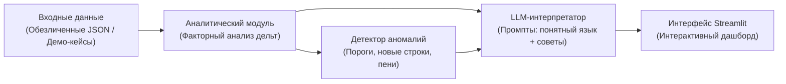

# 🏠 UtilityLens — «Объясни мою квитанцию»

> **Интеллектуальный помощник по ЖКХ:** расшифровывает начисления простым языком, сравнивает месяцы, разделяет рост цен на «тариф» и «потребление», подсвечивает аномалии и скрытые переплаты.

---

## 📌 Проблема

Квитанция ЖКХ для обычного человека — это стресс и информационный шум:
- **Непонятные аббревиатуры:** *СОИ, ОДН, ГВС Тн, ХВС для ГВС, водоотведение*.
- **«Почему счет вырос на 1 500 ₽?»:** непонятно, то ли семья потратила больше воды/света, то ли выросли городские тарифы, то ли управляющая компания включила перерасчет.
- **Риск переплат и ошибок:** сложно заметить внезапно приписанную услугу, задвоенный норматив или просроченную поверку счетчика.

---

## 💡 Наше решение

**UtilityLens** превращает сухую бюрократическую таблицу в понятный интерактивный отчет с ответами на главные вопросы:

1. **Факторный анализ (Тариф vs Объем):**
   Математическое разложение дельты:
   $$\Delta \text{Сумма} = \text{Влияние тарифа} + \text{Влияние объема потребления} + \text{Новые/разовые строки}$$
   *Пример: «Из +1 200 ₽ за отопление: +900 ₽ — из-за морозов сожгли больше тепла, +300 ₽ — плановое повышение тарифа с 1 декабря».*

2. **«Переводчик с ЖКХ на человеческий» (AI-интерпретатор):**
   Генерирует карточки с простыми пояснениями по каждой строке без канцелярита.

3. **Детектор аномалий и предупреждений:**
   - Скачки расхода выше среднего (>30%).
   - Появление новых услуг, которых не было в прошлом месяце.
   - Начисление по нормативу вместо показаний счетчиков (напоминание о поверке).
   - Штрафы, пени и перерасчеты за прошлые периоды.

4. **Интерактивный дашборд (Streamlit):**
   Наглядные графики «было / стало», водопадные диаграммы изменений и фильтры по категориям (Вода, Тепло, Электричество, Общедомовые).

---

## 🏗 Архитектура решения



### Стек технологий
- **Ядро и аналитика:** Python 3.10+, Pandas, Pydantic
- **Интерфейс:** Streamlit, Plotly (интерактивные графики)
- **AI-слой:** LLM-интерпретатор (структурированный вывод объяснений, подсказок и рекомендаций)
- **Данные:** Набор эталонных обезличенных сценариев + загрузка пользовательских данных

---

## 🎯 Сценарии для демонстрации жюри (MVP)

Для стабильной презентации на хакатоне подготовлены 3 показательных кейса в 1 клик:

| № | Сценарий | В чем суть кейса | Что увидит пользователь |
|---|---|---|---|
| **1** | **«Зимний скачок отопления»** | Январь vs Декабрь. Объем вырос из-за морозов. | Четкое разделение: тариф не менялся, рост вызван объемом гигакалорий. |
| **2** | **«Индексация тарифов»** | Июль vs Июнь. Расход ресурсов прежний. | Подсветка: «Вы потратили столько же воды, но тариф вырос на 9%». |
| **3** | **«Аномалия и перерасчет»** | Появилась строка перерасчета за прошлый год + скачок ОДН. | Красный алерт: «Внимание: добавлена разовая строка +2 100 ₽, проверьте правомерность в УК». |

---

## 🗺 Дорожная карта реализации на хакатоне

- [x] Формирование видения и архитектурной концепции
- [ ] Определение схемы данных квитанции (Pydantic-модели)
- [ ] Генерация набора обезличенных тестовых квитанций (демо-данные)
- [ ] Реализация движка факторного анализа (расчет дельт тарифа и объема)
- [ ] Разработка модуля детекции аномалий (правила + эвристики)
- [ ] Интеграция LLM для генерации карточек с понятными объяснениями
- [ ] Создание интерфейса на Streamlit (карточки, графики, выбор сценариев)
- [ ] Подготовка питча и финального демо для жюри

---

## 🚀 Быстрый запуск (планируемый)

```bash
# 1. Клонировать репозиторий
git clone https://github.com/vladStar223/UtilityLen.git
cd UtilityLen

# 2. Создать виртуальное окружение и активировать
python -m venv .venv
source .venv/bin/activate  # для Linux/macOS
# .venv\Scripts\activate   # для Windows

# 3. Установить зависимости
pip install -r requirements.txt

# 4. Запустить дашборд
streamlit run app.py
```
