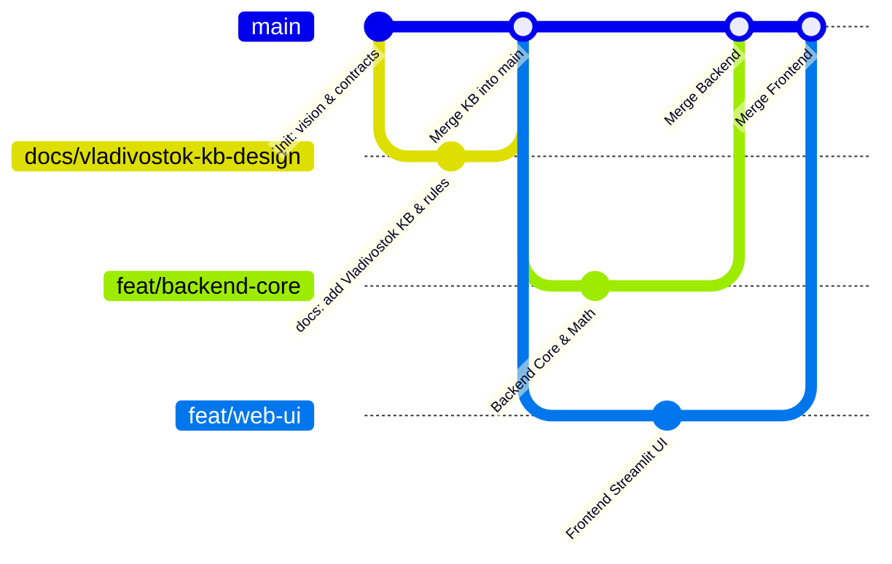
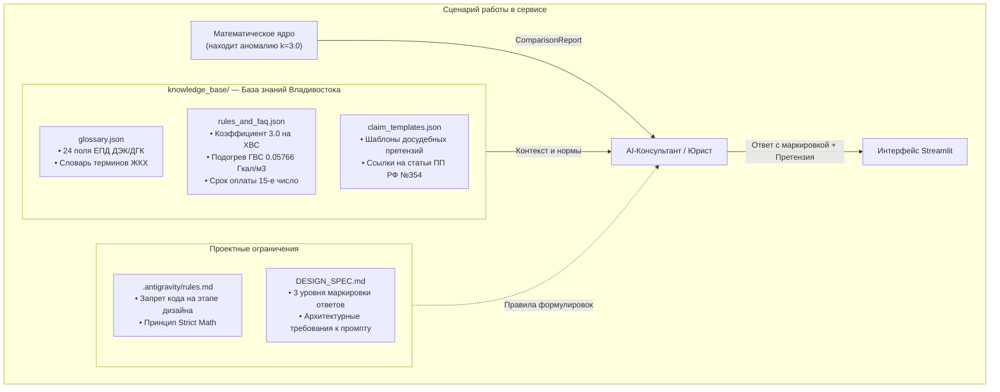

# 🛠️ Регламент работы с базой знаний, архитектура взаимодействия и целевая структура файлов проекта UtilityLens

> **Проект:** UtilityLens («Объясни мою квитанцию», г. Владивосток)  
> **Текущий этап:** Проектирование архитектуры и предметной области (No Code)  
> **Рабочая ветка:** `docs/vladivostok-kb-design`  
> **Связанный Pull Request:** [GitHub PR #1](https://github.com/vladStar223/UtilityLen/pull/new/docs/vladivostok-kb-design)  

---

## 📑 Содержание

1. [Организация работы с веткой `docs/vladivostok-kb-design` в Git](#1-организация-работы-с-веткой-docsvladivostok-kb-design-в-git)
2. [Архитектура и логика работы базы знаний (`docs/vladivostok_kb_design/`)](#2-архитектура-и-логика-работы-базы-знаний)
   - [2.1. Роль каждого файла в ветке](#21-роль-каждого-файла-в-ветке)
   - [2.2. Принцип Strict Deterministic Math + LLM Explanation](#22-принцип-strict-deterministic-math--llm-explanation)
   - [2.3. Трехуровневая маркировка утверждений](#23-трехуровневая-маркировка-утверждений)
   - [2.4. Сквозной сценарий обработки аномалий и составления претензии](#24-сквозной-сценарий-обработки-аномалий-и-составления-претензии)
   - [2.5. Надежность (Fallback) и защита персональных данных (152-ФЗ)](#25-надежность-fallback-и-защита-персональных-данных-152-фз)
3. [Целевая структура файлов проекта (Implementation Plan)](#3-целевая-структура-файлов-проекта-implementation-plan)
   - [3.1. Иерархическое дерево проекта](#31-иерархическое-дерево-проекта)
   - [3.2. Матрица ответственности и назначение будущих файлов](#32-матрица-ответственности-и-назначение-будущих-файлов)

---

## 1. Организация работы с веткой `docs/vladivostok-kb-design` в Git

Разработка проекта строится по командному принципу **Contract-First + Directory Isolation**. На этапе проектирования база знаний Владивостока изолирована в отдельной ветке.



### Регламент взаимодействия:
1. **Единый источник правды:** Ветка `docs/vladivostok-kb-design` содержит нормативные правила Владивостока 2026 года, справочники поставщиков и формулы, исключающие разночтения между разработчиками.
2. **Слияние в `main`:** Перед переходом к кодингу ветка сливается в основную ветку `main` через Pull Request. Все рабочие ветки функционала (`feat/backend-core`, `feat/web-ui`) ответвляются от актуального `main`.
3. **Режим «Frozen Directory Lock»:** Каталог `docs/vladivostok_kb_design/` объявляется **замороженным**. Разработчикам бэкенда и фронтенда запрещено изменять эти файлы: они используются исключительно в режиме чтения (Read-Only) как спецификация для логики расчетов и промптов.

---

## 2. Архитектура и логика работы базы знаний

База знаний связывает детерминированное математическое ядро, слой безопасности и языковую модель:



### 2.1. Роль каждого файла в ветке

| Файл | Содержимое | Назначение и использование в системе |
|---|---|---|
| **`DESIGN_SPEC.md`** | Спецификация промпта AI-юриста и 3 уровня разметки информации | Обязывает модель маркировать каждый вывод: `[Факт из квитанции]`, `[Математический расчет]`, `[Аналитическая гипотеза]`. Запрещает галлюцинации в цифрах. |
| **`.antigravity/rules.md`** | Архитектурные правила проектирования, константы Приморья, запрет кода | Инструкция для Antigravity: вычисления строго детерминированы, оффлайн-fallback при задержке $> 3$ сек, маскирование ПДн по 152-ФЗ. |
| **`knowledge_base/glossary.json`** | Построчное описание **всех 24 полей ЕПД** ДЭК/ДГК и терминов ЖКХ | Источник тултипов для таблицы услуг во фронтенде и справочник понятий для AI-юриста без бюрократического канцелярита. |
| **`knowledge_base/rules_and_faq.json`** | Константы Владивостока 2026 года (коэффициент 3.0, подогрев ГВС 0.05766, старт тепла 12 октября) | Нормативная база для детектора аномалий и источник мгновенного оффлайн-ответа при сбое внешней сети на защите. |
| **`knowledge_base/claim_templates.json`** | Юридически выверенные шаблоны досудебных претензий (ПП РФ № 354, ЗоЗПП РФ) | Шаблоны заявлений с подстановкой адресата (УК, КГУП «Примводоканал», АО «РКЦ ЖКХ г. Владивостока») и точной суммы ущерба. |

### 2.2. Принцип Strict Deterministic Math + LLM Explanation
* **Никаких вычислений в LLM:** Вся математика (разложение общей дельты на влияние изменения тарифа, объема и штрафов) вычисляется детерминированным Python-кодом.
* Входные данные для LLM — это готовый структурированный отчет `ComparisonReport`, содержащий точные числа до копейки. Модель отвечает исключительно за формулирование мыслей, понятный перевод терминов и составление юридических документов.

### 2.3. Трехуровневая маркировка утверждений
AI-юрист обязан структурировать каждый вывод по трем уровням достоверности:
1. `[Факт из квитанции]` — прямое извлечение из документа (например: *«В строке ХВС указан способ расчета (1) по нормативу, применен коэффициент 3.0»*).
2. `[Математический расчет]` — результат вычисления детерминированного ядра (например: *«Переплата за расчетный месяц составила 1 029.00 руб., при этом плата за водоотведение начислена без штрафа»*).
3. `[Аналитическая гипотеза]` — юридическое толкование причины (например: *«Вероятная причина: истечение межповерочного интервала счетчика холодной воды, указанного в Поле 17 квитанции»*).

### 2.4. Сквозной сценарий обработки аномалий и составления претензии
1. Пользователь выбирает квитанции за октябрь и ноябрь.
2. Математическое ядро находит расхождение: объем воды не менялся, но платеж вырос в 2 раза из-за применения коэффициента 3.0. Выставляется флаг аномалии `APPLYING_COEFF_3_0` с суммой ущерба `impact_rub = 1029.00`.
3. AI-юрист сопоставляет аномалию с файлом `rules_and_faq.json` и выводит пользователю карточку с пошаговыми рекомендациями:
   * Проверить дату поверки счетчика во ФГИС «АРШИН»;
   * Заказать поверку на дому без снятия пломбы;
   * Направить акт поверки в расчетный центр.
4. По клику на кнопку «Составить претензию» из `claim_templates.json` берется шаблон заявления в АО «РКЦ ЖКХ г. Владивостока» / КГУП «Приморский водоканал», куда автоматически подставляются точные реквизиты, сумма переплаты и ссылки на п. 31(д) и 60(1) ПП РФ № 354.

### 2.5. Надежность (Fallback) и защита персональных данных (152-ФЗ)
* **Автономный оффлайн-fallback:** Если обращение к внешнему API модели занимает более 3 секунд или завершается ошибкой квоты, система подставляет статический текст консультации из `rules_and_faq.json` и предзаполненный шаблон претензии из `claim_templates.json`.
* **Защита ПДн:** Перед отправкой данных в LLM слой безопасности заменяет ФИО на плейсхолдер `Собственник помещения`, адрес — на `г. Владивосток, МКД`, а номер лицевого счета маскируется (`40702***1234`). Реальные данные подставляются в претензию только локально при скачивании файла.

---

## 3. Целевая структура файлов проекта (Implementation Plan)

### 3.1. Иерархическое дерево проекта

```text
UtilityLen/
├── contracts/                               # [FROZEN / Архитектор] Спецификации JSON-API
│   ├── bill_schema.json                    # Каноническая схема квитанции BillDocument
│   └── compare_response.json               # Эталонный ответ эндпоинта /api/v1/compare
│
├── data/                                   # [FROZEN / Архитектор] Обезличенные демо-данные
│   ├── cases/                              # Демо-кейсы Владивостока в 1 клик
│   │   ├── case_01_heating_vladivostok/    # Кейс 1: Зимний скачок отопления (ОДПУ ДГК)
│   │   ├── case_02_coeff_30_primvodokanal/ # Кейс 2: Штрафной коэффициент 3.0 на ХВС
│   │   └── case_03_soi_spike_recalc/       # Кейс 3: Скачок СОИ и навязанное страхование
│   └── knowledge_base/                     # Общая база знаний сервиса
│
├── docs/                                   # Проектная документация и база знаний
│   ├── SYSTEM_DESIGN.md                    # Комплексный системный проект (архитектура, NFR, ERD)
│   ├── KVITANCII_PRIMORYE_REFERENCE.md     # Справочник квитанций, формул и фото Владивостока
│   ├── BRANCH_WORKFLOW_AND_STRUCTURE.md    # Этот документ (регламент и будущие файлы)
│   ├── agents/                             # Регламенты разработки (00, 01, 02, 03)
│   └── vladivostok_kb_design/              # [FROZEN] База знаний Владивостока (ветка docs)
│       ├── .antigravity/rules.md           # Правила Antigravity для этапа проектирования
│       ├── DESIGN_SPEC.md                  # Спецификация системного промпта AI-юриста
│       └── knowledge_base/
│           ├── glossary.json               # Расшифровка 24 полей ЕПД и терминов
│           ├── rules_and_faq.json          # Константы Владивостока 2026 года
│           └── claim_templates.json        # Шаблоны досудебных претензий
│
├── backend/                                # [АГЕНТ 1 и 2] Серверная часть (FastAPI)
│   ├── Dockerfile                          # Контейнеризация бэкенд-сервиса
│   ├── requirements.txt                    # Зависимости: fastapi, uvicorn, pydantic, httpx
│   ├── app/
│   │   ├── main.py                         # Главная точка входа FastAPI приложения
│   │   ├── api/
│   │   │   ├── cases.py                    # GET /api/v1/cases (список сценариев)
│   │   │   ├── compare.py                  # POST /api/v1/compare (факторный анализ)
│   │   │   └── chat.py                     # POST /api/v1/chat/stream (SSE-стриминг)
│   │   ├── core/
│   │   │   ├── models.py                   # Pydantic v2 схемы (BillDocument, ComparisonReport)
│   │   │   ├── normalizer.py               # Сопоставление услуг ДЭК, ДГК, Примводоканала
│   │   │   └── analyzer.py                 # Детерминированное ядро факторного анализа
│   │   ├── ingestion/
│   │   │   └── qr_parser.py                # Декодер банковского QR ГОСТ Р 56042-2014
│   │   └── agent/
│   │       ├── runner.py                   # Оркестратор AI-юриста с SSE-генератором
│   │       ├── tools.py                    # Поиск по glossary.json и rules_and_faq.json
│   │       └── claim_drafter.py            # Генератор претензий из claim_templates.json
│   └── tests/
│       ├── test_analyzer.py                # Автотесты сходимости факторных дельт до 0.01 ₽
│       └── test_agent.py                   # Автотесты точности формулировок и статей закона
│
├── web/                                    # [АГЕНТ 3] Пользовательский интерфейс (Streamlit)
│   ├── Dockerfile                          # Контейнеризация фронтенд-сервиса
│   ├── requirements.txt                    # Зависимости: streamlit, plotly, requests
│   ├── app.py                              # Главная страница и компоновка дашборда
│   ├── api_client.py                       # Адаптер: переключатель Mock-режим ↔ Реальный API
│   └── components/
│       ├── sidebar.py                      # Выбор демо-сценариев Владивостока в 1 клик
│       ├── kpi_cards.py                    # Карточки светофора (сумма, дельта, драйвер роста)
│       ├── waterfall_chart.py              # Интерактивный график Plotly Waterfall
│       ├── service_table.py                # Таблица «Было / Стало» с подсказками полей
│       └── chat_widget.py                  # Интерактивный чат с юристом и кнопка претензии
│
└── deploy/
    └── docker-compose.yml                  # Оркестрация сборки Backend (8000) и Frontend (8501)
```

### 3.2. Матрица ответственности и назначение будущих файлов

| Модуль / Файл | Владелец | Назначение |
|---|---|---|
| `backend/app/core/models.py` | Агент 1 (Бэкенд) | Строгие Pydantic v2 модели со спецификацией типов и валидацией округления денежных полей до 2 знаков. |
| `backend/app/core/analyzer.py` | Агент 1 (Бэкенд) | Реализация формул факторного анализа ($\Delta S_{\text{тариф}}$, $\Delta S_{\text{объем}}$, $\Delta S_{\text{штраф}}$) и сходимости баланса. |
| `backend/app/core/normalizer.py` | Агент 1 (Бэкенд) | Алгоритм сопоставления разнородных названий услуг из квитанций в канонические коды категорий. |
| `backend/app/ingestion/qr_parser.py` | Агент 1 (Бэкенд) | Парсер строки ГОСТ Р 56042-2014, сверка суммы квитанции с суммой в QR-коде (`Sum=...`). |
| `backend/app/agent/runner.py` | Агент 2 (AI-юрист) | Пайплайн системного промпта, передача контекста без вычислений и потоковая генерация ответа через Server-Sent Events (SSE). |
| `backend/app/agent/tools.py` | Агент 2 (AI-юрист) | Функции извлечения юридических справок из `glossary.json` и `rules_and_faq.json`. |
| `backend/app/agent/claim_drafter.py` | Агент 2 (AI-юрист) | Сборка текста досудебной претензии на базе `claim_templates.json` с автоподстановкой параметров. |
| `web/api_client.py` | Агент 3 (Фронтенд) | Переключатель `USE_MOCK_API`: локальное чтение JSON-моков при верстке или HTTP-запросы к FastAPI. |
| `web/components/waterfall_chart.py` | Агент 3 (Фронтенд) | Интерактивная водопадная диаграмма Plotly: Базовый счет $\rightarrow$ +Тариф $\rightarrow$ +Расход $\rightarrow$ +Штраф $\rightarrow$ Итоговый счет. |
| `web/components/chat_widget.py` | Агент 3 (Фронтенд) | Виджет чата с юристом, поддержка стриминга и генерация кнопки копирования текста претензии. |
